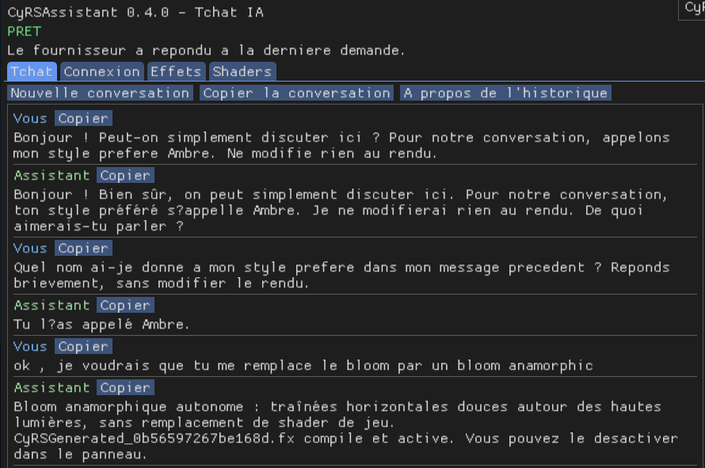
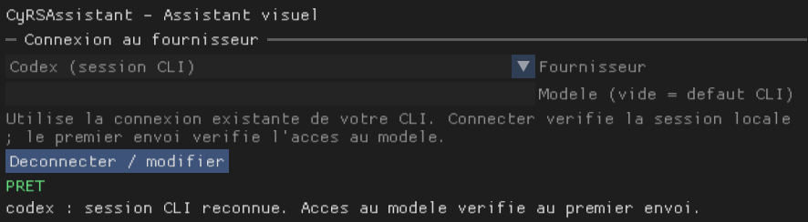

<table width="100%">
  <tr>
    <td width="300" align="left" valign="top">
      <a href="https://mrmybal.github.io/CyRSAssistant/Documentation.html#/fr/start">Documentation</a><br>
      <a href="https://github.com/MrMybal/CyRSAssistant/releases">Versions publiées</a><br>
      <a href="https://github.com/MrMybal/CyRSAssistant">Dépôt</a><br><br>
      <sub>README</sub><br>
      <a href="README.md">English</a> · <a href="README.fr.md">Français</a>
    </td>
    <td width="400" align="center" valign="middle">
      
    </td>
    <td width="300" align="right" valign="top">
      <p><sub>Licence de l’application</sub><br><a href="LICENSE"><strong>GPL-3.0-only</strong></a></p>
      <p><sub>Version</sub><br><a href="VERSION.fr.md"><strong>0.9.0</strong></a><br><strong>PROTOTYPE</strong></p>
      <p><a href="https://github.com/MrMybal/CyRSAssistant/releases/download/v0.9.0/CyRSAssistant-0.9.0-windows-x64.zip"><strong>Télécharger</strong></a><br><sub>Windows x64 · préversion</sub></p>
    </td>
  </tr>
</table>

<h1 align="center">CyRSAssistant</h1>
<p align="center">Par Cyberalien</p>

Un assistant IA intégré à ReShade pour les joueurs qui veulent décrire un style, inspecter leurs effets installés et régler le rendu pendant une partie. Discutez avec un fournisseur connecté, générez des effets ReShade FX et remplacez des pixel shaders du jeu sélectionnés.

> **PROTOTYPE · 0.9.0**
>
> Une version Windows x64 publiée pour les essais et les retours. La qualité du rendu et la compatibilité restent à évaluer dans chaque jeu. Consultez les [notes de version et limites documentées](VERSION.fr.md).

[](assets/screenshots/chat-preview.png)

*Tchat dans la version de développement 0.4.0, avec l’interface en français. La version actuelle comporte des commandes supplémentaires.*

## À propos de CyRSAssistant

Choisissez **Codex CLI**, **Claude Code CLI**, une **API compatible OpenAI** ou un **modèle local** dans Connexion. Le service d’arrière-plan démarre depuis le panneau et indique son état de connexion. Une session CLI reconnue est vérifiée au premier message pour confirmer l’accès effectif au modèle.

Décrivez votre demande dans Tchat. L’assistant peut inspecter les véritables noms de fichiers, techniques, paramètres, valeurs, bornes et descriptions des effets, puis utiliser ses outils pour lire une source FX ou le désassemblage d’un shader natif capturé si nécessaire. Il peut modifier des réglages, générer un FX ou remplacer un effet sélectionné. Vous pouvez relire les valeurs, annuler la dernière modification et enregistrer explicitement le preset actif.

[](assets/screenshots/connection-preview.png)

*Choix du fournisseur et état de la session locale dans une version de développement antérieure.*

L’interface démarre en **anglais** ; choisissez **Options > Language > Français** pour le français. Dans **Options > Mode d’autorisation**, choisissez **Automatique**, **À la demande** ou **Accès complet aux outils ReShade**. Ces modes contrôlent les lectures et modifications de cet add-on ; l’écriture par MCP externe s’active séparément avec `--allow-write`. Voir [les autorisations](https://mrmybal.github.io/CyRSAssistant/Documentation.html#/fr/permissions).

Le panneau conserve jusqu’à 32 messages en mémoire. Les échanges récents et les données pertinentes des shaders accompagnent les demandes au fournisseur sélectionné, y compris après un changement de fournisseur. L’historique disparaît à la fermeture du jeu ; une nouvelle conversation efface le contexte local sans restaurer le rendu. Les clés API restent en mémoire pour la session. Les paramètres du fournisseur, la langue et le mode d’autorisation sont enregistrés dans ReShade.ini. Voir [l’historique et les données transmises](https://mrmybal.github.io/CyRSAssistant/Documentation.html#/fr/history-privacy).

## Fonctionnalités

- **Réglage des effets en direct** : inspecter les paramètres nommés, appliquer des valeurs validées, annuler la dernière modification et enregistrer un preset.
- **Création et remplacement de FX** : compiler des effets générés avec des contrôles nommés, les activer et conserver en mémoire la restauration du dernier remplacement.
- **Pixel shaders DX11/DX12** : inspecter les shaders capturés par empreinte, vérifier les signatures et contrats de ressources, puis activer un remplacement compatible à la prochaine utilisation par le jeu.
- **Catalogue portable des effets** : suivre les ajouts et changements, demander des descriptions et exporter/importer les métadonnées.
- **Clients MCP externes** : exposer les lectures prises en charge et l’écriture optionnelle aux agents compatibles, notamment les clients utilisés avec OpenCode ou Antigravity.
- **Aide illustrée bilingue** : 26 pages par langue, recherche, images, schémas SVG, thèmes, positions de lecture et exemples d’API publique dans le [lecteur HTML](https://mrmybal.github.io/CyRSAssistant/Documentation.html#/fr/start).

---

## Installation

Nécessite un **jeu Windows 64 bits avec ReShade 6.8 et la prise en charge complète des add-ons**. Python et le runtime DXC sont intégrés. Les fournisseurs CLI nécessitent leur propre CLI installé et une session ouverte ; les API et modèles locaux nécessitent une adresse de service et un modèle.

1. [Téléchargez CyRSAssistant 0.9.0 pour Windows x64](https://github.com/MrMybal/CyRSAssistant/releases/download/v0.9.0/CyRSAssistant-0.9.0-windows-x64.zip). Les [notes de publication et empreintes de contrôle](https://github.com/MrMybal/CyRSAssistant/releases/tag/v0.9.0) accompagnent le ZIP.
2. Fermez le jeu. Sauvegardez l’ancien add-on, le compagnon, le runtime et les notices, puis extrayez le ZIP à côté de la DLL ReShade en conservant tous les dossiers. Gardez votre ReShade.ini, vos presets, vos shaders générés et le catalogue CyRSAssistant/library.
3. Lancez le jeu et ouvrez **CyRSAssistant** dans ReShade. Choisissez un fournisseur dans **Connexion**, connectez-vous, puis écrivez dans **Tchat** et cliquez sur **Envoyer** ou appuyez sur **Ctrl+Entrée**.
4. Ouvrez **Aide > Ouvrir la documentation**, un bouton d’aide contextuel ou **F1** lorsque le panneau CyRSAssistant a le focus. Vous pouvez aussi ouvrir directement `CyRSAssistant/Documentation/Documentation.html`.

Conservez tout le dossier `CyRSAssistant/Documentation`, y compris `DocAI.md` et `DocData/`. Le lecteur fourni fonctionne via **file://**, sans serveur, CDN ni connexion Internet. Le [manuel en ligne](https://mrmybal.github.io/CyRSAssistant/Documentation.html#/fr/start) fournit le même lecteur. Voir [l’installation](https://mrmybal.github.io/CyRSAssistant/Documentation.html#/fr/install) et [la mise à jour ou le retour arrière](https://mrmybal.github.io/CyRSAssistant/Documentation.html#/fr/update).

## Sources, compilation et bibliothèques nécessaires

<details>
<summary>Compiler l’add-on Windows et le compagnon</summary>

Utilisez Windows x64, Visual Studio 2022 avec C++ et Windows SDK, Node.js 22+ avec npm et **Python 3.11.5**. Utilisez cette version de Python pour `build/packaging-env` ; la compilation du compagnon la vérifie par rapport aux notices de licence fournies.

```powershell
git clone https://github.com/MrMybal/CyRSAssistant.git
cd CyRSAssistant
python tools/bootstrap.py
npm --prefix .CyDocBuild ci --omit=peer
python tools/build.py
python -m venv build/packaging-env
build/packaging-env/Scripts/python.exe -m pip install pyinstaller==6.20.0
python tools/build_service.py
python -m unittest discover -s tests -p 'test_*.py'
python tools/package.py --install
python tools/package.py
```

Les scripts de préparation récupèrent les versions épinglées de ReShade, Dear ImGui, nlohmann/json et Microsoft DXC. L’archive locale CyDoc et le fichier de verrouillage npm fournissent le générateur documentaire. Seul le module image est inclus dans le lecteur ; les schémas sont des SVG statiques.

Le ZIP d’installation est `dist/CyRSAssistant-0.9.0-windows-x64.zip`. Le ZIP développeur, `dist/CyRSAssistant-0.9.0.zip`, contient les sources correspondantes et les instructions de compilation. Lancez l’add-on compilé dans le jeu via ReShade ; le compagnon démarre depuis le panneau.

</details>

---

## Licence

CyRSAssistant par Cyberalien utilise [GPL-3.0-only](LICENSE). Les composants tiers conservent leurs propres licences. Les textes et notices complets sont fournis en anglais dans [LICENCES](LICENCES/SOURCES.txt), à la racine des deux distributions.

### Bibliothèques et outils tiers

| Bibliothèque · sources | Licence · texte | Utilisation / périmètre |
| --- | --- | --- |
| [ReShade 6.8.0](https://github.com/crosire/reshade/tree/v6.8.0) | [BSD-3-Clause](LICENCES/ReShade.txt) | API native d’add-on et pont du panneau ; ReShade est installé séparément. |
| [Dear ImGui 1.92.5-docking](https://github.com/ocornut/imgui/tree/v1.92.5-docking) | [MIT](LICENCES/DearImGui.txt) | Interface du panneau via le pont ImGui de ReShade. |
| [nlohmann/json 3.12.0](https://github.com/nlohmann/json/tree/v3.12.0) | [MIT](LICENCES/nlohmann-json.txt) | Protocole JSON natif. |
| [Microsoft DXC 1.8.2505.32](https://www.nuget.org/packages/Microsoft.Direct3D.DXC/1.8.2505.32) | [LLVM/NCSA](LICENCES/DXC-LLVM.txt) et [conditions Microsoft](LICENCES/DXC-Microsoft.txt) | Compilateur et validateur DXIL intégrés pour les shaders DX12. |
| [CPython 3.11.5](https://github.com/python/cpython/tree/v3.11.5) | [PSF et notices des composants](LICENCES/Python.txt) | Runtime intégré au compagnon ; les [notices complémentaires](LICENCES/AssistantRuntime-Notices.txt) couvrent ses bibliothèques. |
| [PyInstaller 6.20.0](https://github.com/pyinstaller/pyinstaller/tree/v6.20.0) | [GPL-2.0-or-later avec exception du bootloader ; hooks d’exécution Apache-2.0](LICENCES/PyInstaller.txt) | Création du compagnon, bootloader et hooks d’exécution intégrés. |
| [Runtime C/C++ Microsoft](https://visualstudio.microsoft.com/license-terms/vs2022-cruntime/) | [Conditions Microsoft](LICENCES/Microsoft-Visual-C-Runtime.docx) et [notice du runtime Windows](LICENCES/Microsoft-Windows-Runtime.txt) | Composants natifs de la distribution Windows. |
| [CyDoc 0.1.0](https://github.com/MrMybal/CyDoc/tree/6ddf9a582defb2f11fbb3f992afef6f98dcadc93) | [MIT](LICENCES/CyDoc.txt) | Lecteur local et module image intégrés ; révision et empreinte de l’archive épinglées. |
| [Node.js 22+](https://github.com/nodejs/node) | [MIT et notices des composants](https://github.com/nodejs/node/blob/v22.x/LICENSE) | Génération documentaire pendant la compilation. |
| [marked 17.0.6](https://github.com/markedjs/marked/tree/v17.0.6) | [MIT](https://github.com/markedjs/marked/blob/v17.0.6/LICENSE.md) | Compilation Markdown pendant la génération. |
| [PrismJS 1.30.0](https://github.com/PrismJS/prism/tree/v1.30.0) | [MIT](https://github.com/PrismJS/prism/blob/v1.30.0/LICENSE) | Coloration syntaxique pendant la génération. |
| [esbuild 0.25.12](https://github.com/evanw/esbuild/tree/v0.25.12) | [MIT](https://github.com/evanw/esbuild/blob/v0.25.12/LICENSE.md) | Assemblage du lecteur pendant la génération. |

Ce tableau est un index. Conservez les [notices tierces complètes](THIRD_PARTY.md), les [références des sources](LICENCES/SOURCES.txt) et les notices à côté des DLL DXC. Les outils de génération ne s’exécutent pas dans l’application installée.

## Références et liens

- [Documentation française](https://mrmybal.github.io/CyRSAssistant/Documentation.html#/fr/start) · [English documentation](https://mrmybal.github.io/CyRSAssistant/Documentation.html#/en/start).
- [Dépôt des sources](https://github.com/MrMybal/CyRSAssistant) · [Versions publiées](https://github.com/MrMybal/CyRSAssistant/releases) · [Suivi des problèmes](https://github.com/MrMybal/CyRSAssistant/issues).
- [Notes de version](VERSION.fr.md) · [Installation et connexion](https://mrmybal.github.io/CyRSAssistant/Documentation.html#/fr/install).
