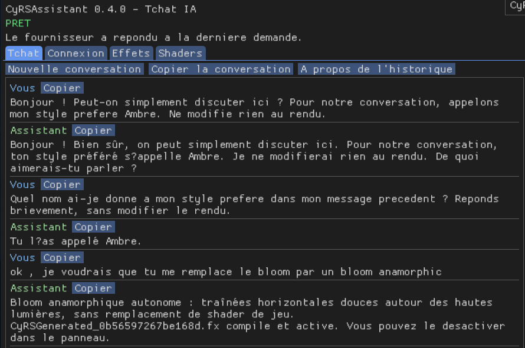
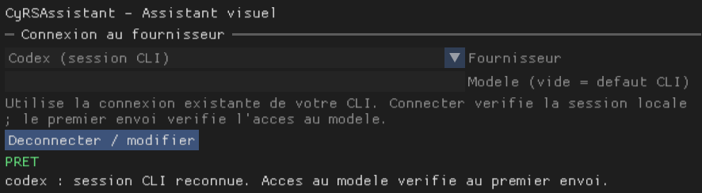

<table width="100%">
  <tr>
    <td width="300" align="left" valign="top">
      <a href="https://mrmybal.github.io/CyRSAssistant/Documentation.html#/en/start">Documentation</a><br>
      <a href="https://github.com/MrMybal/CyRSAssistant/releases">Releases</a><br>
      <a href="https://github.com/MrMybal/CyRSAssistant">Repository</a><br><br>
      <sub>README</sub><br>
      <a href="README.md">English</a> · <a href="README.fr.md">Français</a>
    </td>
    <td width="400" align="center" valign="middle">
      
    </td>
    <td width="300" align="right" valign="top">
      <p><sub>Application license</sub><br><a href="LICENSE"><strong>GPL-3.0-only</strong></a></p>
      <p><sub>Version</sub><br><a href="VERSION.md"><strong>0.10.0</strong></a><br><strong>PROTOTYPE</strong></p>
      <p><a href="https://github.com/MrMybal/CyRSAssistant/releases/download/v0.10.0/CyRSAssistant-0.10.0-windows-x64.zip"><strong>Download 0.10.0</strong></a><br><sub>Windows x64 · prerelease</sub></p>
    </td>
  </tr>
</table>

<h1 align="center">CyRSAssistant</h1>
<p align="center">By Cyberalien</p>

An AI assistant inside ReShade for players who want to describe a look, inspect their installed effects and adjust rendering while the game is running. Chat with a connected provider, generate ReShade FX and replace selected game pixel shaders.

> **PROTOTYPE · 0.10.0**
>
> Version 0.10.0 includes CyMCPSDK conversations, the native CLI and MCP in the Windows package. Rendering quality and compatibility need evaluation in each game. Read the [version notes and documented limitations](VERSION.md).

[](assets/screenshots/chat-preview.png)

*Chat in development version 0.4.0, with the interface in French. The current release has additional controls.*

Version 0.10.0 adds CyMCPSDK conversations with streamed text, cancellation, optional private session restore and attachments. Its native CLI and MCP server share the rendering tools and application permissions. Existing Python commands remain available.

## About CyRSAssistant

Choose **Codex**, **Claude Code**, **OpenCode ACP**, **Antigravity**, supported API profiles or an existing **local model service** in Connection. The background service starts from the overlay and reports its connection state. A recognized CLI login is checked for actual model access on the first message.

Describe what you want in Chat. The assistant can inspect real effect filenames, techniques, parameter names, values, bounds and descriptions, then use tools to read FX source or captured native shader disassembly when needed. It can adjust settings, generate an FX or replace a selected effect. You can verify values, undo the last edit and explicitly save the active preset.

[](assets/screenshots/connection-preview.png)

*Provider selection and local session status in an earlier development build.*

The interface starts in **English**; select **Options > Language > Français** for French. In **Options > Permission mode**, choose **Automatic**, **Ask each time** or **Full access to ReShade tools**. These modes control this add-on's reads and edits; external MCP writing is separately enabled with `--allow-write`. See [permissions](https://mrmybal.github.io/CyRSAssistant/Documentation.html#/en/permissions).

The 0.10.0 overlay keeps full in-memory history; optional SDK checkpoints preserve private sessions. State polling returns the latest 32 messages. Recent messages and relevant shader data accompany requests to the selected provider, including after a provider switch. Without optional session persistence, history disappears when the game closes; starting a new conversation clears the local context without restoring the rendering. API keys stay in session memory. Provider settings, language and permission mode are saved in ReShade.ini. See [history and provider data](https://mrmybal.github.io/CyRSAssistant/Documentation.html#/en/history-privacy).

## Features

- **Live effect editing:** inspect named settings, apply validated values, undo the last edit and save a preset.
- **FX creation and replacement:** compile generated effects with named controls, activate them and retain restoration of the last replacement in memory.
- **DX11/DX12 pixel shaders:** inspect captured shaders by fingerprint, check signatures and resource contracts, and activate a compatible replacement at the next game bind.
- **Portable effect catalog:** track additions and changes, request descriptions and export/import metadata.
- **External MCP clients:** expose supported reads and optional writes to compatible agents, including clients used with OpenCode or Antigravity.
- **Shared SDK tools:** 27 application operations with schemas, version checks and the same rendering permissions in chat, CLI and MCP.
- **Bilingual illustrated help:** 27 pages per language, search, images, SVG diagrams, themes, reading positions and public API examples in the [HTML reader](https://mrmybal.github.io/CyRSAssistant/Documentation.html#/en/start).

---

## Installation

Requires a **64-bit Windows game with ReShade 6.8 and full add-on support**. Python and the DXC runtime are bundled. The native binaries also require the Microsoft Visual C++ 2015–2022 x64 runtime. CLI providers require their own installed CLI and login; API and local-model connections require an endpoint and model.

1. [Download CyRSAssistant 0.10.0 for Windows x64](https://github.com/MrMybal/CyRSAssistant/releases/download/v0.10.0/CyRSAssistant-0.10.0-windows-x64.zip). [Release notes and checksums](https://github.com/MrMybal/CyRSAssistant/releases/tag/v0.10.0) accompany the ZIP.
2. Close the game. Back up the previous add-on, companion, native CLI, runtime and notices, then extract the ZIP next to the ReShade DLL, keeping all folders. Keep your ReShade.ini, presets, generated shaders, CyRSAssistant/library catalog and private SDK settings/history.
3. Start the game and open **CyRSAssistant** in ReShade. Choose a provider in **Connection**, connect, then write in **Chat** and click **Send** or press **Ctrl+Enter**.
4. Open **Help > Open documentation**, a contextual Help button or **F1** while the CyRSAssistant overlay has focus. You can also open `CyRSAssistant/Documentation/Documentation.html` directly.

Keep the complete `CyRSAssistant/Documentation` directory, including `DocAI.md` and `DocData/`. The bundled reader works through **file://**, without a server, CDN or Internet connection. The [online manual](https://mrmybal.github.io/CyRSAssistant/Documentation.html#/en/start) uses the same reader but currently documents 0.9.0. Open the bundled manual for the complete 0.10.0 guide, including CyMCPSDK settings, session restore and native CLI/MCP use. See [installation](https://mrmybal.github.io/CyRSAssistant/Documentation.html#/en/install) and [updating or rolling back](https://mrmybal.github.io/CyRSAssistant/Documentation.html#/en/update).

## Source, build and required libraries

<details>
<summary>Build the Windows add-on and companion</summary>

Use Windows x64, Visual Studio 2022 with C++ and Windows SDK, Node.js 22+ with npm, and **Python 3.11.5**. Use that Python version for `build/packaging-env`; the companion build checks it against the bundled license notices.

```powershell
git clone https://github.com/MrMybal/CyRSAssistant.git
cd CyRSAssistant
python tools/bootstrap.py
npm --prefix .CyDocBuild ci --omit=peer
python tools/build.py
python -m venv build/packaging-env
build/packaging-env/Scripts/python.exe -m pip install pyinstaller==6.20.0
python tools/build_service.py
python -m unittest discover -s tests -p 'test_*.py'
python tools/package.py --install
python tools/package.py
```

The bootstrap scripts fetch pinned ReShade, Dear ImGui, nlohmann/json and Microsoft DXC dependencies. The local CyDoc archive and npm lockfile supply the documentation generator. Only the image module is included in the reader; the diagrams are static SVG.

The installation ZIP is `dist/CyRSAssistant-0.10.0-windows-x64.zip`. The developer ZIP, `dist/CyRSAssistant-0.10.0.zip`, includes corresponding sources and build instructions. Launch the built add-on through ReShade in the game; the companion starts from the overlay.

</details>

---

## License

CyRSAssistant by Cyberalien uses [GPL-3.0-only](LICENSE). Third-party components retain their own licenses. The complete texts and notices are supplied in English in [LICENCES](LICENCES/SOURCES.txt), at the root of both distributions.

### Third-party libraries and tools

| Library · source | License · terms | Use / scope |
| --- | --- | --- |
| [ReShade 6.8.0](https://github.com/crosire/reshade/tree/v6.8.0) | [BSD-3-Clause](LICENCES/ReShade.txt) | Native add-on API and overlay bridge; ReShade is installed separately. |
| [Dear ImGui 1.92.5-docking](https://github.com/ocornut/imgui/tree/v1.92.5-docking) | [MIT](LICENCES/DearImGui.txt) | Overlay interface through ReShade's ImGui bridge. |
| [nlohmann/json 3.12.0](https://github.com/nlohmann/json/tree/v3.12.0) | [MIT](LICENCES/nlohmann-json.txt) | Native JSON protocol. |
| [Microsoft DXC 1.8.2505.32](https://www.nuget.org/packages/Microsoft.Direct3D.DXC/1.8.2505.32) | [LLVM/NCSA](LICENCES/DXC-LLVM.txt) and [Microsoft terms](LICENCES/DXC-Microsoft.txt) | Bundled DXIL compiler and validator for DX12 shaders. |
| [CPython 3.11.5](https://github.com/python/cpython/tree/v3.11.5) | [PSF and component notices](LICENCES/Python.txt) | Bundled companion runtime; [additional runtime notices](LICENCES/AssistantRuntime-Notices.txt) cover its libraries. |
| [PyInstaller 6.20.0](https://github.com/pyinstaller/pyinstaller/tree/v6.20.0) | [GPL-2.0-or-later with bootloader exception; Apache-2.0 runtime hooks](LICENCES/PyInstaller.txt) | Companion packaging, embedded bootloader and runtime hooks. |
| [Microsoft C/C++ runtime](https://visualstudio.microsoft.com/license-terms/vs2022-cruntime/) | [Microsoft terms](LICENCES/Microsoft-Visual-C-Runtime.docx) and [Windows runtime notice](LICENCES/Microsoft-Windows-Runtime.txt) | Native components of the Windows distribution. |
| [CyMCPSDK 0.7.0](https://github.com/MrMybal/CyMCPSDK/tree/791d4d7d7680213b282ec8529d248a10f8494d77) | [MIT](LICENCES/CyMCPSDK.txt), [cpp-httplib MIT](LICENCES/cpp-httplib.txt), [PicoSHA2 MIT](LICENCES/PicoSHA2.txt) | Native Core, Platform, Http, MCP and AI in the 0.10.0 package. |
| [CyDoc 0.1.0](https://github.com/MrMybal/CyDoc/tree/6ddf9a582defb2f11fbb3f992afef6f98dcadc93) | [MIT](LICENCES/CyDoc.txt) | Bundled local reader and image module; pinned by commit and package hash. |
| [Node.js 22+](https://github.com/nodejs/node) | [MIT and component notices](https://github.com/nodejs/node/blob/v22.x/LICENSE) | Documentation generation at build time. |
| [marked 17.0.6](https://github.com/markedjs/marked/tree/v17.0.6) | [MIT](https://github.com/markedjs/marked/blob/v17.0.6/LICENSE.md) | Build-time Markdown compilation. |
| [PrismJS 1.30.0](https://github.com/PrismJS/prism/tree/v1.30.0) | [MIT](https://github.com/PrismJS/prism/blob/v1.30.0/LICENSE) | Build-time syntax highlighting. |
| [esbuild 0.25.12](https://github.com/evanw/esbuild/tree/v0.25.12) | [MIT](https://github.com/evanw/esbuild/blob/v0.25.12/LICENSE.md) | Build-time reader bundling. |

This table is an index. Retain the complete [third-party notices](THIRD_PARTY.md), [source references](LICENCES/SOURCES.txt) and notices beside the DXC DLLs. Generation tools do not run inside the installed application.

## Native CLI and MCP

Create `read-parameters.json` containing `{"runtime":1}` before the live call below.

```powershell
CyRSAssistantCLI.exe tools
CyRSAssistantCLI.exe describe cyrs_get_parameters
CyRSAssistantCLI.exe --args-file read-parameters.json call cyrs_get_parameters
CyRSAssistantCLI.exe mcp
```

Use `--pipe` for multiple games. Live tools need a running ReShade instance. Writes require `--allow-write` and still obey the overlay approval mode. Optional settings are independently configured in `CyRSAssistant/sdk-options.json`; see the bundled manual’s CyMCPSDK chapter.

## References and links

- [English documentation](https://mrmybal.github.io/CyRSAssistant/Documentation.html#/en/start) · [Documentation française](https://mrmybal.github.io/CyRSAssistant/Documentation.html#/fr/start).
- [Source repository](https://github.com/MrMybal/CyRSAssistant) · [Releases](https://github.com/MrMybal/CyRSAssistant/releases) · [Issue tracker](https://github.com/MrMybal/CyRSAssistant/issues).
- [Version notes](VERSION.md) · [Installation and connection](https://mrmybal.github.io/CyRSAssistant/Documentation.html#/en/install).
