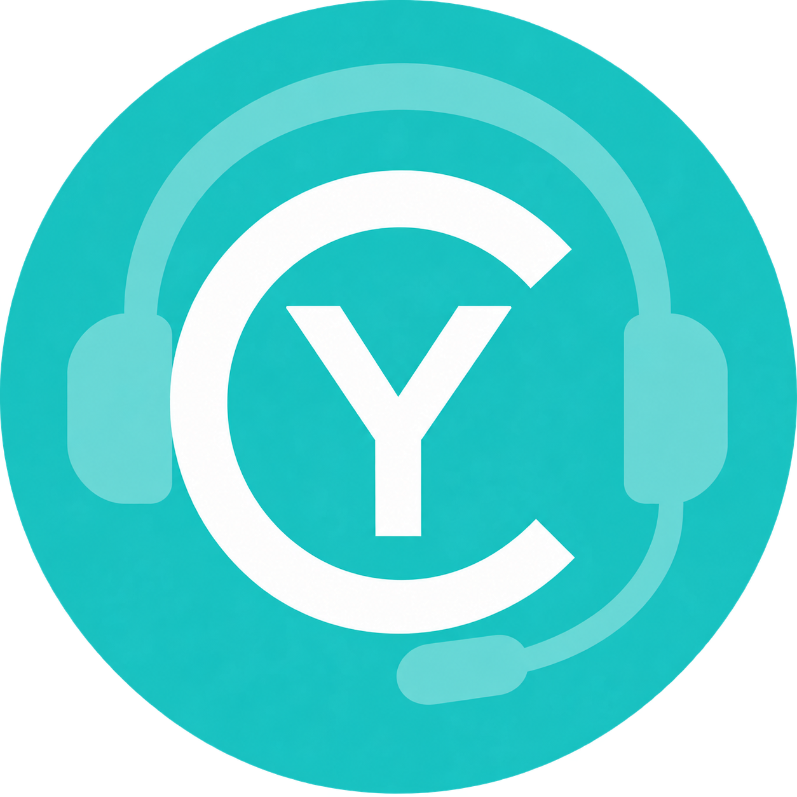
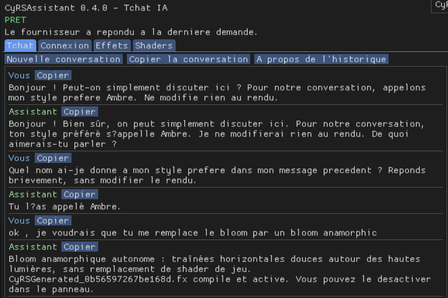
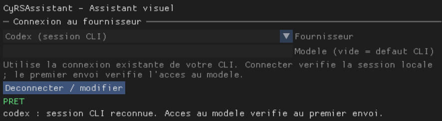

<p align="center">
  
</p>

# CyRSAssistant

English | [Français](README.fr.md)

**[Documentation](https://mrmybal.github.io/CyRSAssistant/Documentation.html#/en/start)** — searchable English manual, images and diagrams. It covers version 0.9.0. Offline help remains included in application packages.

An AI assistant inside ReShade. Chat about the look you want, inspect installed effects and their actual parameters, adjust a preset, generate effects and replace selected game shaders.

Version 0.9.0 is a Windows x64 prototype built against ReShade 6.8 / API 20. FX generation and temporary pixel shader replacement have been exercised in Stray with DX11 and DX12. DXIL compilation and Shader Model 6 PSO creation have also been tested on a DX12 device. Visual quality still needs evaluation in each game.

## Built-in CyDoc help

Open **CyRSAssistant > Help > Open documentation**, or use a contextual Help button. The bundled reader opens via **file://**, in English by default or French following Options. It includes 26 pages per language: user guides, public API references and short code examples. Images enlarge inside the reader; static diagrams are compiled to SVG. Search, keyboard/touch navigation, code copying, reading positions and printing are provided by CyDoc.

Keep the complete **CyRSAssistant/Documentation** directory, including **Documentation.html**, **DocAI.md** and **DocData/**. No server, CDN, Internet, Node.js or separate reader installation is required to read it. Old index.en.html/index.fr.html links redirect locally. Only the **image** module is shipped; no Three.js.

## Language

The interface defaults to **English**. Select **Options > Language > Français** to switch to French. The setting is saved for this game and takes effect without restarting. New assistant responses use the selected language unless you explicitly request another language. Existing conversation messages remain unchanged; an ongoing request finishes in its original language.

Translations for the overlay and companion share JSON catalogs. See [Language and reading controls](https://mrmybal.github.io/CyRSAssistant/#/en/localization).

## Features

- Chat with Codex CLI, Claude Code CLI, an OpenAI-compatible API or a local model. The background service starts from the overlay and reports connection status.
- Inspect real effect filenames, techniques, parameter names, values, bounds, descriptions and FX source. The assistant can read more information through tools as needed.
- Adjust settings, verify applied values, undo the last edit and explicitly save the active preset.
- Generate standalone ReShade FX with named controls. Replace an existing FX by compiling a new effect, disabling the old one and keeping its source for restoration.
- Inspect captured DX11/DX12 pixel shaders, compile replacements, check signatures and resource contracts, and activate them at the next game bind.
- Maintain a disk catalog with fingerprints, changes, generated descriptions and portable metadata export/import.
- Connect external MCP clients for reads and, with `--allow-write`, supported edits.

## Screenshots

Screenshots from earlier development builds, with the interface in French.

**AI chat (v0.4.0)** — conversation history and an example effect request.



**Provider connection** — CLI provider selection and local session status.



## Get started

Download [**CyRSAssistant-0.9.0-windows-x64.zip**](https://github.com/MrMybal/CyRSAssistant/releases/download/v0.9.0/CyRSAssistant-0.9.0-windows-x64.zip) from [release v0.9.0](https://github.com/MrMybal/CyRSAssistant/releases/tag/v0.9.0), or build it locally with `python tools/package.py --install`. Close the game and extract it next to the ReShade DLL, keeping the folders. The add-on, companion and runtime folder are already at the ZIP root; Python is bundled.

Read the [installation and connection guide](https://mrmybal.github.io/CyRSAssistant/#/en/install). No terminal is needed for normal use from ReShade.

In **Options > Permission mode**, choose:

- **Automatic** (default): requested reads and actions run without extra approval; one rendering operation per message.
- **Ask each time**: review each rendering change and each source/disassembly read before transmission to the provider. Names and values remain directly readable.
- **Full access to ReShade tools**: the assistant can chain multiple rendering operations to complete a request.

These permissions cover this add-on's tools. They do not grant a terminal or arbitrary filesystem access, change the Codex application's permissions, or override the separate MCP write setting. Changing permission mode cancels the pending request. Ambiguous targets can still require clarification.

## Build

Requires Windows x64, Visual Studio 2022 with C++, Windows SDK and Node.js 22 or later for generating the documentation. The companion distribution uses Python 3.11.5 and PyInstaller 6.20.0; use Python 3.11.5 to create `build/packaging-env`. The build verifies the interpreter and matching license texts before freezing.

```powershell
python tools/bootstrap.py
npm --prefix .CyDocBuild ci --omit=peer
python tools/build.py
python -m venv build/packaging-env
build/packaging-env/Scripts/python.exe -m pip install pyinstaller==6.20.0
python tools/build_service.py
python -m unittest discover -s tests -p 'test_*.py'
python tools/package.py
```

For the ready-to-install ZIP, run `python tools/package.py --install`; it writes `dist/CyRSAssistant-0.9.0-windows-x64.zip`. The default command produces `dist/CyRSAssistant-0.9.0.zip` with sources and developer tools. Dependencies use pinned versions and checksums from their official projects. CyGameCapture and CyGPUInspector are not dependencies.

## Current limits

There is no shader-pack downloading, automatic screenshot analysis or automatic HUD identification yet. Native replacement supports captured DX11/DX12 pixel shaders; other stages and Vulkan are not supported. A shader may be shared by several objects. The assistant receives disassembly and reflection, not the game's original HLSL, and may decline an uncertain reconstruction. Replacements are not automatically restored after restarting the game.

Technique order is not changed. Undo keeps one edit in memory and can be invalidated by an inventory change or reload. Saving writes the active preset; automatic historical preset backups are not implemented.

OpenCode and Antigravity can use the MCP interface from their own clients; they do not have direct provider connectors in the overlay yet. A recognized CLI login does not guarantee model access; the first message checks it. Responses are displayed when completed, without streaming.

## Conversation and provider data

The overlay keeps up to 32 messages in memory. Recent exchanges accompany requests to the selected provider, including after switching providers. Starting a new conversation clears the local context without restoring rendering changes. Runtime history disappears when the game closes; this does not delete records retained by the provider.

The API key stays in memory for the current session. Provider, model, endpoint, language and permission mode are saved in ReShade.ini. Provider requests include the relevant chat and shader data required by the selected tools. Compiler output and existing shader annotations retain their original language.

## License

CyRSAssistant by Cyberalien is licensed under GPL-3.0-only. See [LICENSE](LICENSE), [THIRD_PARTY.md](THIRD_PARTY.md) and [LICENCES/SOURCES.txt](LICENCES/SOURCES.txt). Every distribution includes the complete license folder at its root. See [installation and rollback](https://mrmybal.github.io/CyRSAssistant/#/en/update/overview) before updating an existing game.
